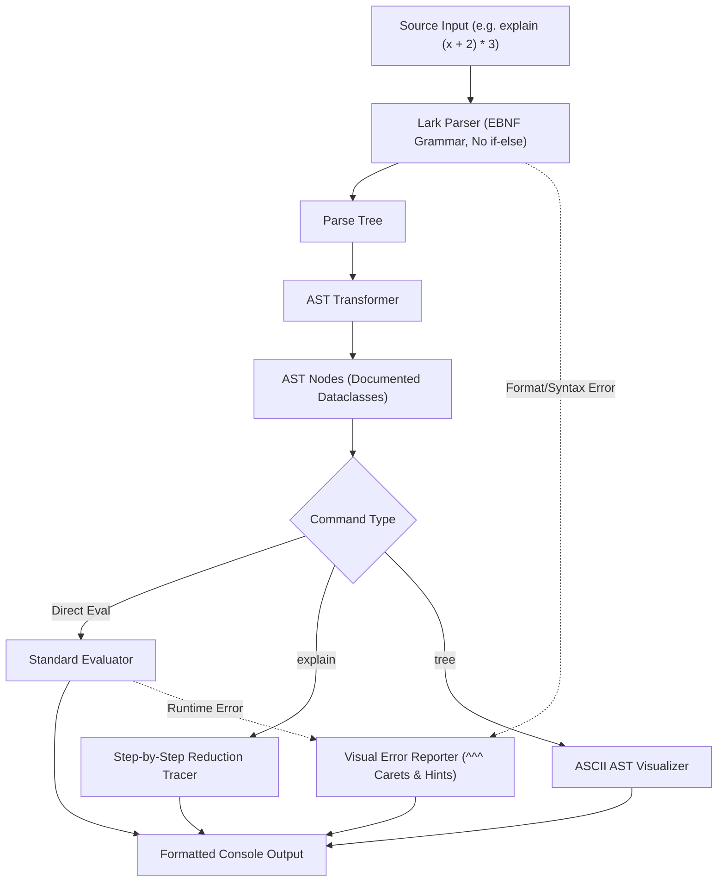

# StepCalc: Language Architecture & Implementation Plan
**CMPSC 132: Programming Languages — Final Project**

---

## 1. Executive Summary

**StepCalc** is an educational, integer-focused programming language designed to demonstrate core compiler and language design principles. Built using the modern **Lark** parsing library, StepCalc completely avoids naive `if-else` text processing, compiling declarative **EBNF (Extended Backus-Naur Form)** grammar rules directly into an Abstract Syntax Tree (AST).

In addition to standard integer arithmetic and variable storage, StepCalc features an **On-Demand Step-by-Step Explainer & AST Visualizer**, making it a unique "pedagogical tutor" language that shows exactly how expressions evaluate step-by-step.



---

## 2. Alignment with CMPSC 132 Grading Rubric (100 / 100 Pts)

| Rubric Criterion | Max Pts | Target Score | How StepCalc Satisfies It |
| :--- | :---: | :---: | :--- |
| **Requirements** | 20 | **20 pts** (90–100%) | Complete integer arithmetic (`+`, `-`, `*`, `/`, `%`, `^`), unary minus, parentheses, variable assignment, zero `if-else` text processing, and robust format error handling. |
| **Delivery** | 20 | **20 pts** (On time) | Ready well ahead of deadline (October 30, 2026, 17:00), bundled with an automated ZIP packaging script. |
| **Documentation** | 20 | **20 pts** (Clearly & effectively documented) | Comprehensive Google/Sphinx-style docstrings describing **all class variables and attributes**, formal EBNF grammar specification, and a detailed **PL Evaluation Criteria** analysis. |
| **Runtime** | 20 | **20 pts** (Executes without errors, excellent prompts) | Interactive REPL (`calc> ` prompt), command options (`explain`, `tree`, `:vars`, `:help`), visual caret (`^^^`) error pointers, and support for running `.calc` script files. |
| **Presentation** | 20 | **20 pts** (Deep understanding, advanced features) | Built-in AST visualizer, step-by-step evaluation derivation engine, and a prepared presentation outline showing CFG parsing, precedence climbing, and AST traversal. |

---

## 3. Formal EBNF Grammar Specification

The language syntax is formally defined without ambiguity, enforcing standard mathematical precedence (**PEMDAS/BODMAS**):
1. Parentheses `(...)`
2. Exponentiation `^` (right-associative)
3. Unary operators `+`, `-`
4. Multiplication `*`, Division `/` (integer floor), Modulo `%` (left-associative)
5. Addition `+`, Subtraction `-` (left-associative)
6. Assignment `=`

```ebnf
program        ::= statement*
statement      ::= assignment | command | expr
assignment     ::= IDENTIFIER "=" expr
command        ::= "explain" expr | "tree" expr | meta_command
meta_command   ::= ":vars" | ":help" | ":clear" | ":exit"

expr           ::= term (("+" | "-") term)*
term           ::= power (("*" | "/" | "%") power)*
power          ::= unary ("^" power)?
unary          ::= ("+" | "-") unary | primary
primary        ::= INTEGER | IDENTIFIER | "(" expr ")"

INTEGER        ::= [0-9]+
IDENTIFIER     ::= [a-zA-Z_][a-zA-Z0-9_]*
```

---

## 4. Codebase Architecture & File Structure

```
d:\_PL\
├── stepcalc/
│   ├── __init__.py           # Package initializer & version
│   ├── grammar.py            # Lark EBNF grammar definition (declarative, zero if-else)
│   ├── ast_nodes.py          # AST dataclasses with explicit class variable docstrings
│   ├── transformer.py        # Converts Lark ParseTree into typed AST nodes
│   ├── evaluator.py          # Environment, Evaluator, and Step-by-Step Reduction Engine
│   ├── errors.py             # Custom Exception hierarchy with visual caret (^^^) formatter
│   └── repl.py               # Interactive CLI shell (calc> ) with formatting & symbols
├── examples/
│   ├── demo.calc             # Sample script showing all arithmetic, variables, and commands
│   └── error_cases.calc      # Sample script demonstrating format & syntax error handling
├── tests/
│   ├── __init__.py
│   └── test_stepcalc.py      # Comprehensive pytest suite (arithmetic, precedence, errors)
├── main.py                   # Main entry point (CLI argument parser for REPL and script mode)
├── package_submission.py     # Helper script to verify tests and build submission ZIP file
└── README.md                 # Complete documentation, PL evaluation criteria, and user manual
```

---

## 5. Detailed Component Specifications

### 5.1 AST Nodes with Explicit Class Variable Descriptions (`ast_nodes.py`)
To achieve the **20/20 Documentation** score, every class explicitly defines and documents its class/instance variables:

```python
class BinOp(ASTNode):
    """Represents a binary arithmetic operation between two expressions.

    Attributes:
        left (ASTNode): The left-hand side operand expression.
        op (str): The operator symbol ('+', '-', '*', '/', '%', or '^').
        right (ASTNode): The right-hand side operand expression.
        line (int): Line number where the operator appears in the source.
        column (int): Column number where the operator appears in the source.
    """
```

### 5.2 Zero `if-else` Text Processing (`grammar.py` & `transformer.py`)
- The Lark library uses LALR(1) / Earley parsing under the hood.
- All tokens and syntax rules are matched through declarative grammar strings and regular expressions.
- The `ASTTransformer` maps parse rules to AST nodes through Python methods matching rule names (e.g., `def add(self, children): ...`), strictly avoiding string-scanning `if-else` cascades.

### 5.3 Step-by-Step Reduction Tracer (`evaluator.py`)
When `explain (2 + 3) * 4` is typed:
1. Evaluates innermost subtrees first according to operator precedence.
2. At each reduction step, serializes the tree back to a human-readable mathematical string.
3. Outputs the sequence:
   ```
   Step 1: (2 + 3) * 4   [evaluate: 2 + 3 = 5]
   Step 2: 5 * 4         [evaluate: 5 * 4 = 20]
   Result: 20
   ```

### 5.4 Visual Error Formatting (`errors.py`)
Catches `UnexpectedCharacters`, `UnexpectedToken`, and runtime errors, printing friendly diagnostics:
```
Syntax Error: Unexpected operator '*' at Line 1, Column 5
  Input:  5 + * 2
              ^
  Hint:   Operator '+' must be followed by a number, variable, or '('.
```

---

## 6. Implementation Checklist & Timeline

- [ ] **Step 1: Install Dependencies** (`pip install lark pytest`)
- [ ] **Step 2: Create `ast_nodes.py`** with comprehensive class variable docstrings
- [ ] **Step 3: Create `grammar.py` & `transformer.py`** implementing the EBNF rules in Lark
- [ ] **Step 4: Create `evaluator.py`** (standard evaluation + step reduction tracer + environment)
- [ ] **Step 5: Create `errors.py`** (format & syntax error handlers with caret pointers)
- [ ] **Step 6: Create `repl.py` & `main.py`** (dual mode: interactive REPL + file runner)
- [ ] **Step 7: Create `tests/test_stepcalc.py`** with complete pytest coverage
- [ ] **Step 8: Write `README.md`** (EBNF grammar, PL evaluation criteria, setup guide)
- [ ] **Step 9: Run Test Suite & Generate Submission ZIP** (`package_submission.py`)
